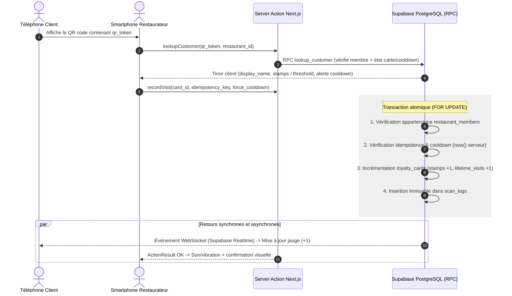

# Fidly — Architecture Logicielle & Flux Techniques

## 1. Stack Technique (cf. ADR-001 → ADR-007)
- **Framework Full-Stack :** Next.js (App Router, TypeScript strict)
- **UI & Style :** Tailwind CSS, shadcn/ui
- **Base de données :** PostgreSQL + PostGIS (Supabase)
- **Authentification :** Supabase Auth (Google OAuth + code OTP 6 chiffres par email — cf. ADR-003)
- **Temps Réel :** Supabase Realtime (WebSocket / PostgreSQL Replication)
- **QR Code :**
  - Génération client : `qrcode.react` (encode un `qr_token` opaque et révocable — cf. ADR-005)
  - Scanner caméra : `@yudiel/react-qr-scanner` (par défaut, à confirmer par le spike 0.3 — cf. ADR-002)
- **Géolocalisation :** PostGIS (`geography` + `ST_DWithin`) + API Adresse data.gouv.fr (BAN — cf. ADR-007)
- **Hébergement & CI/CD :** Vercel (région UE alignée sur Supabase, déploiement continu via Git)

## 2. Flux de Validation de Scan (Temps Réel — ADR-004)

### Diagramme de Séquence
