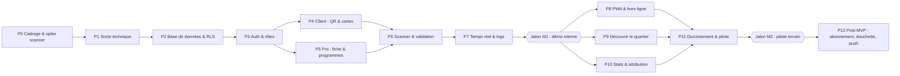
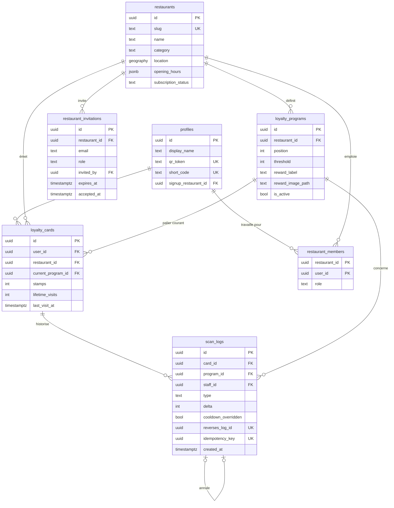

# Fidly — Roadmap d'implémentation

> Plan chronologique, incrémental et testable. Chaque phase produit un livrable **démontrable** et se termine par une **porte de validation** : on ne passe pas à la phase suivante tant que les tests ne sont pas verts.
> Les cases `[ ]` sont cochées au fil de l'eau (cf. Definition of Done dans `.cursorrules` §14).

---

## 🗺️ Vue d'ensemble

| Phase | Livrable démontrable | Effort indicatif* | Risque |
|---|---|---|---|
| P0 | Décisions tranchées + prototype scanner mesuré sur vrais téléphones | 2–3 j | 🔴 (lève le risque n°1) |
| P1 | App vide déployée sur Vercel, CI verte | 1–2 j | 🟢 |
| P2 | Schéma complet, RLS testée, données de seed | 3–4 j | 🔴 |
| P3 | Connexion OTP/Google, routes protégées, invitation pro | 3 j | 🟠 |
| P4 | Écran client avec QR + cartes (données seed) | 2–3 j | 🟢 |
| P5 | Le restaurateur configure sa fiche et ses programmes | 4–5 j | 🟠 |
| P6 | **Scan → +1 passage → récompense, en < 3 s** | 5–6 j | 🔴 |
| P7 | Jauge client animée en direct + onglet logs live | 2–3 j | 🟠 |
| P8 | App installable, QR affichable hors-ligne | 2–3 j | 🟠 |
| P9 | Carte/liste des partenaires dans un rayon 100 m–10 km | 3–4 j | 🟠 |
| P10 | Tableau de bord ROI du restaurateur | 2–3 j | 🟢 |
| P11 | Sécurité, RGPD, monitoring, test réel en service du midi | 4–5 j | 🔴 |

\* Jours de développement effectif, 1 développeur assisté par IA. Total MVP ≈ **35–45 jours**.

### Jalons
- **M1 — Démo interne (fin P7)** : le parcours cœur fonctionne de bout en bout sur 2 téléphones.
- **M2 — Pilote terrain (fin P11)** : 1 restaurant réel, 1 service du midi, temps mesurés.
- **M3 — Commercialisation (P12)** : abonnement actif **avant la fin des 3 mois gratuits** du premier pilote.

---

## 📐 Budget de performance du flux de scan (contrainte produit n°1)

| Étape | Budget | Comment le tenir |
|---|---|---|
| Ouverture scanner (caméra déjà autorisée) | ≤ 800 ms | Module chargé en avance, caméra maintenue « chaude » entre deux scans |
| Détection + décodage du QR | ≤ 500 ms | QR à faible densité (jeton court), contraste maximal, zone de scan restreinte |
| `lookup_customer` (RPC) | ≤ 300 ms | Vercel et Supabase dans la **même région UE**, 1 seul aller-retour, index sur `qr_token` |
| Affichage du tiroir | ≤ 100 ms | Composant pré-monté, pas de chargement d'image bloquant |
| `record_visit` (RPC) | ≤ 400 ms | Transaction unique en base |
| Mise à jour côté client (Realtime) | ≤ 1 s | Abonnement filtré sur la carte du client |
| **Total scan → confirmation commerçant** | **< 3 s** | Mesuré en P0 (prototype), P6 (réel), P11 (terrain) |

---

## 🧱 Modèle de données — proposition à valider en P2

> Le SQL sera écrit ensemble en Phase 2. Ce schéma intègre les décisions de la Session 1 (Q-001 → Q-010, ADR-006, ADR-009, ADR-010) ; Q-011 → Q-013 peuvent encore l'ajuster à la marge.

> **Règles de progression (ADR-009)** : `stamps` = compteur cumulatif sur le cycle courant, sans plafond ; consommation d'un palier intermédiaire ⇒ `stamps` conservé (`13/10 → 13/20`) et passage au palier actif suivant ; consommation du dernier palier ⇒ déduction du seuil final (`20/20 → 0/10` ou `22/20 → 2/10`) et boucle sur le 1er palier. `lifetime_visits` ne décroît jamais (stats). `scan_logs.type` ∈ `visit` · `reward_redeemed` · `reversal` (ADR-010).

---

## Phase 0 — Cadrage & levée des risques

**🎯 Objectif :** trancher les ambiguïtés métier et valider la faisabilité technique du point le plus risqué (scanner caméra en navigateur) **avant** d'écrire du code de production.

### Étapes
- [x] **0.1** Rédaction des règles (`.cursorrules`), du CHANGELOG et de la roadmap.
- [x] **0.2** Répondre aux questions ouvertes **Q-001 → Q-010** et valider/rejeter les ADR « Proposé ».
- [x] **0.3** **Spike scanner** (code jetable, hors dépôt principal) : page Next.js minimale déployée sur Vercel (HTTPS obligatoire pour la caméra), comparant `@yudiel/react-qr-scanner` et `html5-qrcode`.
- [ ] **0.4** Création des comptes : GitHub (✅), Vercel, Supabase (région UE — idéalement la même zone que Vercel), Google Cloud (OAuth), Resend (SMTP), nom de domaine.

### ✅ Tests de validation
- [x] Spike testé : décodage instantané dès l'entrée du QR dans le champ, excellente réactivité.
- [x] Temps « tap sur Scanner → QR décodé » mesuré et validé (objectif ≤ 1,3 s largement respecté).
- [x] Décodage OK et confirmation visuelle/sonore validée.
- [x] Comportement de la permission caméra vérifié.
- [x] ADR-002 confirmé définitivement (`@yudiel/react-qr-scanner` retenu, `html5-qrcode` retiré).

### ⚠️ Points de vigilance
- La caméra n'est accessible qu'en **HTTPS** (ou `localhost`) : tester depuis l'URL Vercel, pas via l'IP locale.
- iOS peut **redemander la permission caméra** en mode PWA standalone : c'est un facteur clé de choix entre « PWA installée » et « onglet Safari épinglé » pour le commerçant.
- Ne pas sur-investir : le spike est jetable, il répond à une seule question (« est-ce assez rapide ? »).

---

## Phase 1 — Socle technique

**🎯 Objectif :** un projet vide mais **industrialisé** : conventions appliquées par l'outillage, déploiement continu fonctionnel.

### Étapes
- [x] **1.1** ⚠️ Déplacer le projet **hors de OneDrive** (ex. `C:\Users\amint\Projet\Fidly`) ou exclure `node_modules`/`.next` de la synchronisation. Initialiser git + `.gitignore` + dépôt GitHub.
- [x] **1.2** `create-next-app` / initialisation Next.js (TypeScript, App Router, Tailwind v4, ESLint, `src/`, alias `@/`), pnpm. Durcir `tsconfig.json` (cf. `.cursorrules` §4).
- [x] **1.3** Prettier + `prettier-plugin-tailwindcss`, règles ESLint (`no-explicit-any`, `max-lines: 150`, `max-lines-per-function: 40`), Husky + `lint-staged` (`.husky/pre-commit`).
- [x] **1.4** shadcn/ui init (`components.json`) + composants de base (`button`, `card`, `drawer`, `input`, `label`, `form`, `sonner`, `skeleton`, `progress`). Design tokens Fidly (couleurs, police, rayon), layout mobile-first.
- [x] **1.5** Arborescence `src/features`, `src/lib`, `lib/env.ts` (validation Zod), `lib/errors.ts` (`ActionResult`, codes d'erreur).
- [x] **1.6** Vitest (4 tests unitaires) + Playwright (`playwright.config.ts` mobile 375×667 + `e2e/smoke.spec.ts`). Scripts `lint`, `typecheck`, `test`, `test:e2e`.
- [x] **1.7** GitHub Actions (`.github/workflows/ci.yml` pour lint + typecheck + test à chaque PR). *(Connexion Vercel : preview par PR, production sur `main`, région UE alignée sur Supabase).*

### ✅ Tests de validation
- [x] `pnpm lint && pnpm typecheck && pnpm test` passent localement (et workflow CI prêt).
- [x] Un fichier de 151 lignes ou un `any` volontaire **fait échouer** le lint (testé puis supprimé).
- [x] Rendu mobile vérifié à 375 px (et preview Vercel prête).
- [x] Démarrage / appel sans variable d'environnement requise ⇒ erreur explicite de `env.ts` (vérifié par test unitaire Vitest).

### ⚠️ Points de vigilance
- OneDrive + `node_modules` = synchronisation de centaines de milliers de fichiers, verrous de fichiers, builds lents et corrompus.
- Figer les versions majeures (Next, React, Supabase) et lire leurs notes de migration : APIs récentes (`params` asynchrones, `middleware` → `proxy` selon la version).
- Ne pas installer de librairies « au cas où ».

---

## Phase 2 — Base de données & sécurité RLS

**🎯 Objectif :** un schéma PostgreSQL complet, versionné, où **la base elle-même garantit** les règles critiques (droits, unicité, immutabilité des logs).

### Étapes
- [x] **2.1** Supabase CLI : `supabase init`, `supabase link`. Projet Supabase Cloud « Dev » lié (`bduimaxjfsojzankmoje`, région `eu-central-1` — cf. ADR-011).
- [x] **2.2** Migration 1 (`20261020090001_extensions_and_enums.sql`) — extensions (`postgis`, `pgcrypto`) et types énumérés (catégorie, rôle membre, statut abonnement, type de log).
- [x] **2.3** Migration 2 (`20261020090002_core_tables.sql`) — tables `profiles`, `platform_admins`, `restaurants`, `restaurant_members`, `restaurant_invitations`, `loyalty_programs`, `loyalty_cards`, `scan_logs` avec contraintes (`CHECK threshold > 0`, `UNIQUE(user_id, restaurant_id)`, `UNIQUE(restaurant_id, position)`, `UNIQUE(idempotency_key)`, `UNIQUE(reverses_log_id)`), index FK + GIST sur `location`.
- [x] **2.4** Migration 3 (`20261020090003_auth_profile_trigger.sql`) — trigger de création de `profiles` à l'inscription (génération `qr_token` aléatoire + `short_code` 6 caractères sans ambiguïté, alphabet sans `0/O/1/I/L`).
- [x] **2.5** Migration 4 (`20261020090004_rls_helpers_and_policies.sql`) — fonctions helpers RLS (`private.is_restaurant_member`, `private.is_restaurant_owner`, `private.is_platform_admin`) en `SECURITY DEFINER` + policies sur toutes les tables.
- [x] **2.6** Migration 5 (`20261020090005_storage_bucket.sql`) — Bucket Storage (`restaurant-media`) + policies (écriture : membres du restaurant ; lecture : publique).
- [x] **2.7** `supabase gen types` → `src/types/database.types.ts` ; `seed.sql` (2 restaurants, 3 programmes, 3 clients, quelques logs).
- [x] **2.8** Tests SQL (`supabase/tests/rls_access_matrix.test.sql` — 20/20 assertions pgTAP vertes via `pnpm db:test`) de la matrice d'accès.

### Matrice d'accès cible (à tester)
| Table | Client (soi-même) | Staff du restaurant | Autre restaurant | Anonyme |
|---|---|---|---|---|
| `profiles` | lire/modifier son `display_name` | lire `display_name` des clients ayant une carte chez lui (via RPC) | ❌ | ❌ |
| `restaurants` | lire (actifs) | modifier le sien (owner) | lire (actifs) | lire (actifs) |
| `loyalty_programs` | lire | CRUD (owner) | lire | lire |
| `loyalty_cards` | lire les siennes, **jamais écrire** | lire celles de son restaurant, écriture via RPC uniquement | ❌ | ❌ |
| `scan_logs` | lire les siens | lire ceux de son restaurant | ❌ | ❌ |
| `scan_logs` UPDATE/DELETE | ❌ | ❌ | ❌ | ❌ |

### ✅ Tests de validation
- [x] `supabase db reset` rejoue toutes les migrations + seed sans erreur.
- [x] Tests SQL verts : chaque ligne de la matrice testée en cas **autorisé ET refusé** (20/20 assertions pgTAP `ok`).
- [x] Un client tentant `update loyalty_cards set stamps = 99` reçoit 0 ligne modifiée / erreur (`42501 permission denied`).
- [x] Un utilisateur ne peut pas s'insérer lui-même dans `restaurant_members` ou `platform_admins` (`42501 permission denied`).
- [x] Advisors Supabase (Security + Performance) : 0 alerte critique (`pnpm db:advisors` : 0 erreur, 0 alerte DB/RLS).
- [x] `pnpm typecheck` passe avec les types générés.

### ⚠️ Points de vigilance
- **RLS oubliée = base ouverte en lecture/écriture** via la clé publique. Activer la RLS dans la même migration que la création de table.
- Les policies qui font des sous-requêtes sur la table elle-même provoquent des **récursions infinies** → passer par des fonctions `SECURITY DEFINER`.
- `SECURITY DEFINER` sans `SET search_path = ''` = faille d'escalade de privilèges.
- Politiques RLS lentes à l'échelle : envelopper `auth.uid()` dans `(select auth.uid())` et indexer les colonnes filtrées.
- Le schéma de `loyalty_cards` applique ADR-009 (`stamps` + `current_program_id` + `lifetime_visits`).

---

## Phase 3 — Authentification & rôles

**🎯 Objectif :** un client se connecte en 1 tap (Google) ou par code email ; un restaurateur invité accède à `/pro` ; personne n'accède à ce qu'il ne doit pas voir.

### Étapes
- [ ] **3.1** `lib/supabase/server.ts`, `client.ts`, middleware/proxy de rafraîchissement de session.
- [ ] **3.2** Page `/login` : bouton Google OAuth + formulaire email → saisie du code OTP à 6 chiffres. Route `/auth/callback`.
- [ ] **3.3** SMTP personnalisé (Resend) + template d'email OTP en français aux couleurs Fidly.
- [ ] **3.4** Onboarding post-inscription : saisie du prénom ou pseudonyme (`display_name`, cf. Q-010) si absent (pré-rempli depuis Google).
- [ ] **3.5** Garde de routes : `/` et `/pro` exigent une session ; `/pro` exige une appartenance à `restaurant_members` ; `/admin` exige `platform_admins`. Redirection vers `/login?next=...`.
- [ ] **3.6** Flux d'invitation restaurateur (ADR-006) : l'admin crée le restaurant et émet une invitation liée à un email (`restaurant_invitations`) → le restaurateur crée lui-même son compte avec cet email → il est rattaché comme `owner` (l'UI d'invitation des employés `staff` est reportée en Post-MVP — Q-011).
- [ ] **3.7** Déconnexion.

### ✅ Tests de validation
- [ ] Connexion Google OK sur iPhone et Android (navigateur **et** PWA installée si déjà disponible).
- [ ] Connexion OTP OK ; code expiré ou erroné ⇒ message clair ; renvoi limité dans le temps.
- [ ] Un client accédant à `/pro` est redirigé ; un staff accède à `/pro` ; seul un admin accède à `/admin`.
- [ ] Session conservée après fermeture/réouverture du navigateur.
- [ ] Modification manuelle du cookie/JWT côté client ⇒ aucun accès supplémentaire (RLS fait foi).
- [ ] E2E Playwright : connexion OTP (via boîte mail locale Inbucket/Mailpit de Supabase en dev).

### ⚠️ Points de vigilance
- **Magic Link en PWA iOS** : le lien s'ouvre dans Safari, pas dans la PWA installée ⇒ session dans le mauvais contexte (raison de l'ADR-003).
- SMTP Supabase par défaut : quelques emails/heure seulement ⇒ inutilisable en conditions réelles.
- Google OAuth : configurer les **URLs de redirection** pour localhost, previews Vercel et production ; l'écran de consentement doit être publié.
- Ne jamais déduire un rôle de `user_metadata`.

---

## Phase 4 — Espace client : QR code & cartes (lecture seule)

**🎯 Objectif :** l'écran principal client est complet et rapide, alimenté par les données réelles (seed).

### Étapes
- [ ] **4.1** Zone Hero fixe : QR (`qrcode.react`, encode `qr_token`), prénom/pseudo (`display_name`), code court de secours lisible (groupé `ABC-123`).
- [ ] **4.2** Domain : `computeCardProgress(card, programs)` (ADR-009) → palier actif (`current_program_id`), `stamps / threshold` cumulatif (ex. `13 / 10` puis `13 / 20`), `isRewardUnlocked`, palier suivant avec boucle sur le 1er en fin de cycle (tests unitaires exhaustifs).
- [ ] **4.3** Liste « Mes cartes » : logo, nom, récompense, barre de progression animée (transition `13/10 → 13/20` lors de la consommation d'un palier intermédiaire, et `20/20 → 0/10` en fin de cycle), état « Récompense disponible en caisse ! » (surbrillance verte).
- [ ] **4.4** États vide (« Faites-vous scanner lors de votre prochain repas »), chargement (skeleton), erreur.
- [ ] **4.5** Persistance locale du `qr_token`/`display_name`/code court pour réaffichage instantané (préparation hors-ligne P8).

### ✅ Tests de validation
- [ ] QR scanné avec succès par le prototype de P0 depuis 3 téléphones différents.
- [ ] Tests unitaires `computeCardProgress` : 0 passage, palier atteint, dépassement (`13/10`), passage au palier suivant (`13/20`), fin de cycle → boucle sur le 1er (`20/20 → 0/10` et `22/20 → 2/10`), programmes réordonnés/modifiés (Q-013).
- [ ] Lighthouse mobile ≥ 90 en Performance sur `/`.
- [ ] Modifier les `stamps` en base (seed) ⇒ affichage correct après rechargement.

### ⚠️ Points de vigilance
- **Lisibilité du QR** : fond blanc pur, marge (quiet zone) suffisante, taille ≥ 200 px, niveau de correction d'erreur `M` ou `Q`. Le web ne peut pas forcer la luminosité de l'écran : conseiller l'utilisateur.
- Le `qr_token` doit rester court (≈ 16–22 caractères) pour un QR peu dense, donc plus rapide à décoder.
- Aucune logique de progression dans les composants : tout passe par `domain/`.

---

## Phase 5 — Espace restaurateur : fiche & programmes

**🎯 Objectif :** un restaurateur configure son établissement et ses programmes en moins de 5 minutes, sans aide.

### Étapes
- [ ] **5.1** Layout `/pro` : navigation basse (Scanner · Logs · Stats · Réglages), sélecteur d'établissement si membre de plusieurs.
- [ ] **5.2** `/pro/settings` — fiche : nom, catégorie, adresse (autocomplétion API Adresse → coordonnées stockées en `geography`), horaires d'ouverture (éditeur par jour, stocké en JSONB validé par Zod).
- [ ] **5.3** Upload logo + couverture : compression/redimensionnement côté client, validation MIME/taille côté serveur, Supabase Storage.
- [ ] **5.4** Programmes : création/édition/suppression (seuil cumulatif, libellé, image de récompense), **réordonnancement par glisser-déposer** (`@dnd-kit`), mise à jour atomique des positions.
- [ ] **5.5** Back-office `/admin` minimal : créer un restaurant, inviter l'owner, générer le **QR du chevalet** (`/?ref=<slug>`) en PDF/PNG imprimable.

### ✅ Tests de validation
- [ ] Chronomètre : un testeur non technique configure une fiche + 2 programmes en < 5 min.
- [ ] Réordonner les programmes ⇒ ordre persistant, aucune position en double (contrainte `UNIQUE` respectée).
- [ ] Upload d'un fichier non-image ou > 5 Mo ⇒ refus explicite.
- [ ] Un staff (non owner) ne peut pas modifier la fiche ni les programmes (UI **et** RLS).
- [ ] Les changements apparaissent côté client (P4) après rechargement.

### ⚠️ Points de vigilance
- **Modifier un programme alors que des clients ont des cartes en cours (Q-013)** : application immédiate du nouveau seuil aux cartes en cours ; la désactivation d'un programme bascule les cartes concernées sur le palier actif suivant en conservant `stamps`.
- Supprimer un programme référencé par des logs ⇒ désactivation (soft delete `is_active = false`), jamais suppression physique.
- Réordonnancement : mise à jour des positions en une transaction (RPC) pour éviter les violations transitoires de `UNIQUE`.
- Images : coût Storage/bande passante ⇒ toujours compresser (WebP, ~800 px max).

---

## Phase 6 — Cœur métier : Scanner & validation de passage 🔴

**🎯 Objectif :** le commerçant scanne le QR client, voit son état et valide +1 passage ou la récompense, **en moins de 3 secondes**, sans doublon possible.

### Étapes
- [ ] **6.1** Composant scanner (librairie validée en P0) chargé via `next/dynamic` (`ssr: false`), bouton géant « Scanner un client », caméra arrière, **flux caméra conservé entre deux scans** (pause du décodage, pas d'arrêt du stream).
- [ ] **6.2** Saisie manuelle du code court de secours (6 caractères, normalisation majuscules, tolérance aux caractères ambigus).
- [ ] **6.3** RPC `lookup_customer(token_or_code, restaurant_id)` : vérifie l'appartenance du staff, retourne `display_name`, carte (ou « nouvelle carte »), programme actif (`current_program_id`), `isRewardUnlocked`, `last_visit_at`, `isInCooldown`.
- [ ] **6.4** Tiroir (Drawer shadcn) : `display_name` + `stamps / threshold` (ex. `4 / 10`, `13 / 10` ou `13 / 20`), bouton **« Valider +1 passage »** (toujours actif, cumul sans plafond), bouton vert **« Valider la récompense »** si palier atteint, **alerte cooldown** si dernier passage < 2 h (validation possible par tout employé avec confirmation explicite, tracée — Q-009).
- [ ] **6.5** RPC `record_visit(card, idempotency_key, force_cooldown)` : transaction, `SELECT … FOR UPDATE`, re-vérification du cooldown côté serveur, création de la carte au 1er passage (1er programme actif), `stamps += 1`, `lifetime_visits += 1`, insertion `scan_logs` (`cooldown_overridden`), retour du nouvel état.
- [ ] **6.6** RPC `redeem_reward(card, idempotency_key)` (ADR-009) : vérifie `stamps >= threshold` ; si palier intermédiaire ⇒ conserve `stamps` et bascule `current_program_id` sur le palier actif suivant (`13/10 → 13/20`) ; si dernier palier ⇒ déduit `threshold` (`stamps -= threshold`) et boucle `current_program_id` sur le 1er palier (`20/20 → 0/10`) ; log `reward_redeemed`.
- [ ] **6.7** Server Actions fines (Zod + appel RPC + mapping `ActionResult`), feedback : son, vibration (Android), animation de succès, fermeture auto du tiroir et retour au scanner prêt.
- [ ] **6.8** RPC `reverse_scan(log_id, idempotency_key)` (ADR-010, Q-012) : annulation par écriture compensatoire `type = reversal` liée via `reverses_log_id` (`UNIQUE`), autorisée pour `owner` (tout scan) et `staff` (ses propres scans < 10 min), restauration atomique de l'état de la carte.

### ✅ Tests de validation
- [ ] **Chronométrage** sur appareil réel, 20 scans consécutifs : médiane < 3 s scan → confirmation, aucun > 5 s.
- [ ] **Double-tap** sur « Valider » ⇒ un seul passage crédité (idempotence).
- [ ] **Deux téléphones staff** scannent le même client simultanément ⇒ un seul crédit sans confirmation, l'autre reçoit l'alerte cooldown.
- [ ] Scan à < 2 h ⇒ alerte affichée ; validation forcée ⇒ log `cooldown_overridden = true`.
- [ ] Palier 1 atteint à `13/10` ⇒ consommation passe la carte à `13/20` sur Palier 2 ; consommation du dernier palier à `20/20` ⇒ boucle à `0/10` sur Palier 1.
- [ ] Annulation d'un scan ⇒ log `reversal` créé, ligne d'origine barrée dans `/pro/logs`, refusée pour un `staff` au-delà de 10 min ou sur le scan d'un collègue, double annulation refusée (`UNIQUE(reverses_log_id)`).
- [ ] QR forgé (token inconnu, chaîne aléatoire, URL malveillante, très longue chaîne) ⇒ message « Client introuvable », aucune erreur 500.
- [ ] Un staff du restaurant A ne peut pas créditer une carte au nom du restaurant B (test SQL + E2E).
- [ ] Code court de secours fonctionnel.
- [ ] Tests pgTAP des RPC (`lookup_customer`, `record_visit`, `redeem_reward`, `reverse_scan`) + test E2E Playwright du parcours complet.

### ⚠️ Points de vigilance
- **Latence caméra** : l'initialisation de `getUserMedia` coûte 300 ms à 1 s+ ; ne la payer qu'une fois par session de service. Libérer la caméra quand l'onglet passe en arrière-plan (batterie, confidentialité).
- **Scans multiples du même QR** : les librairies émettent plusieurs détections par seconde ⇒ verrouiller après la 1re détection jusqu'à fermeture du tiroir.
- **Anti-doublon à deux niveaux** : idempotence (même action rejouée) ≠ cooldown (deux actions distinctes rapprochées). Les deux sont nécessaires.
- **Heure serveur uniquement** (`now()` en base) pour le cooldown — jamais l'horloge du téléphone.
- **Région** : un aller-retour Vercel ↔ Supabase transatlantique ajoute ~150 ms par requête. Si le budget n'est pas tenu malgré l'alignement des régions, envisager l'appel RPC direct depuis le navigateur (la RPC étant sécurisée en base).
- Ne jamais afficher de succès optimiste : le commerçant doit être sûr que le point est enregistré.
- Réseau faible en salle : timeout clair + bouton « Réessayer » réutilisant **la même** clé d'idempotence.

---

## Phase 7 — Temps réel & journal d'audit

**🎯 Objectif :** le client voit sa jauge progresser en direct au moment du scan ; le commerçant suit chaque scan en direct dans l'onglet Logs.

### Étapes
- [ ] **7.1** Publication Realtime sur `loyalty_cards` (et `scan_logs`) ; hook `use-loyalty-cards-realtime` filtré par `user_id`, cleanup du channel.
- [ ] **7.2** Animation côté client : +1 sur la barre, transition fluide vers le nouvel objectif lors de la consommation d'une récompense (`13/10 → 13/20` puis `20/20 → 0/10`), effet de célébration quand la récompense est débloquée (respect de `prefers-reduced-motion`).
- [ ] **7.3** `/pro/logs` : liste paginée côté serveur (date, `display_name`, type, staff, dépassement cooldown signalé, **ligne barrée mais lisible si annulée** via `reverses_log_id`) + nouvelles entrées insérées en direct en tête.
- [ ] **7.4** Resynchronisation au retour au premier plan (`visibilitychange`) et à la reconnexion réseau.

### ✅ Tests de validation
- [ ] Deux téléphones : scan sur le téléphone pro ⇒ jauge du client mise à jour en < 1 s **sans rechargement**.
- [ ] Le client A ne reçoit **jamais** d'événement concernant le client B (vérifier dans l'onglet réseau/WebSocket).
- [ ] App client en arrière-plan pendant le scan ⇒ état correct au retour.
- [ ] Logs live : un scan sur un 2e appareil staff apparaît sur le 1er.
- [ ] Pas de fuite de channels : navigation répétée ⇒ nombre de connexions stable.

### ⚠️ Points de vigilance
- Vérifier que la RLS s'applique bien aux événements `postgres_changes` (tables ajoutées à la publication `supabase_realtime`).
- iOS suspend les WebSockets en arrière-plan : la resynchronisation est indispensable, le Realtime n'est qu'un « bonus » de fraîcheur.
- Quotas Realtime du plan gratuit (connexions simultanées, messages) : à surveiller en P11.

---

## 🏁 Jalon M1 — Démo interne
Parcours complet sur 2 téléphones : inscription client → configuration restaurant → scan → +1 en direct → récompense → log. Démo enregistrée en vidéo.

---

## Phase 8 — PWA & hors-ligne

**🎯 Objectif :** Fidly s'installe sur l'écran d'accueil en 1 clic et le QR client s'affiche **même sans réseau**.

### Étapes
- [ ] **8.1** `app/manifest.ts` (nom, icônes 192/512 + maskable, `theme_color`, `display: standalone`, `start_url`), icônes Apple et splash screens.
- [ ] **8.2** Service worker (Serwist, successeur de next-pwa) : mise en cache du shell de l'app et de l'écran QR ; stratégie *network-first* pour les données.
- [ ] **8.3** Bannière d'installation : `beforeinstallprompt` sur Android ; instructions illustrées « Partager → Sur l'écran d'accueil » sur iOS ; affichage après un 1er passage réussi, refus mémorisé.
- [ ] **8.4** Indicateur hors-ligne discret et données de cartes « dernière mise à jour à… ».

### ✅ Tests de validation
- [ ] Lighthouse : critères PWA installable remplis.
- [ ] Mode avion après une 1re visite ⇒ le QR s'affiche instantanément et reste scannable.
- [ ] Installation testée sur iOS Safari et Android Chrome ; ouverture en plein écran.
- [ ] Nouvelle version déployée ⇒ l'app installée se met à jour sans bloquer l'utilisateur sur une ancienne version.

### ⚠️ Points de vigilance
- **Cache de service worker obsolète** = bugs fantômes après déploiement : versionner, prévoir un mécanisme de mise à jour.
- Ne jamais mettre en cache des réponses authentifiées sensibles ou les pages `/pro`.
- iOS : pas de `beforeinstallprompt`, stockage pouvant être purgé après inactivité ⇒ le QR doit pouvoir être régénéré dès le retour du réseau.

---

## Phase 9 — Découvrir le quartier

**🎯 Objectif :** le client découvre les restaurants partenaires où il n'est pas encore allé, autour de sa position ou d'une adresse, dans un rayon de 100 m à 10 km.

### Étapes
- [ ] **9.1** RPC `nearby_restaurants(lat, lng, radius_m)` : `ST_DWithin` sur `geography`, exclut les restaurants où le client a déjà une carte, tri par distance, pagination.
- [ ] **9.2** Géolocalisation navigateur (sur action explicite de l'utilisateur) + recherche par adresse (autocomplétion API Adresse, debounce 300 ms).
- [ ] **9.3** Curseur de rayon 100 m → 10 km (échelle non linéaire) synchronisé dans l'URL (`?r=500&lat=…&lng=…`).
- [ ] **9.4** Carte restaurant : logo, catégorie, distance, offre de bienvenue/1er palier, ouvert/fermé maintenant (domain `isOpenNow`), lien itinéraire.

### ✅ Tests de validation
- [ ] Position refusée ⇒ repli fluide sur la recherche par adresse.
- [ ] Rayon 100 m vs 10 km ⇒ résultats cohérents avec les distances réelles (vérifiées sur une carte).
- [ ] Restaurants avec une carte existante absents de la liste.
- [ ] `EXPLAIN ANALYZE` : la requête utilise l'index GIST.
- [ ] Tests unitaires `isOpenNow` (fuseau Europe/Paris, horaires après minuit, jours fermés).

### ⚠️ Points de vigilance
- **RGPD** : la position ne transite que pour la requête, n'est **jamais stockée**.
- PostGIS : ordre **longitude, latitude** dans `ST_MakePoint` (source d'erreur classique).
- Fuseaux horaires et heure d'été pour « ouvert maintenant ».
- Respecter les conditions d'usage de l'API Adresse (débit) ; mettre en cache les géocodages côté serveur.

---

## Phase 10 — Statistiques restaurateur & attribution

**🎯 Objectif :** prouver le ROI pendant les 3 mois gratuits (argument de conversion n°1 du business model).

### Étapes
- [ ] **10.1** Attribution : un client inscrit via le QR du chevalet (`?ref=slug`) est rattaché au restaurant d'origine (`signup_restaurant_id`).
- [ ] **10.2** RPC/vues agrégées : clients inscrits via le restaurant, clients actifs, passages par jour/semaine, **taux de retour** (clients avec ≥ 2 passages), récompenses consommées, clients « venus via le réseau Fidly ».
- [ ] **10.3** `/pro/stats` : indicateurs clés + graphiques simples (shadcn charts) sur 7 / 30 / 90 jours.

### ✅ Tests de validation
- [ ] Chiffres du tableau de bord vérifiés à la main contre des requêtes SQL sur le seed.
- [ ] Un restaurant ne voit que ses propres statistiques (test RLS).
- [ ] Temps de chargement `/pro/stats` < 1 s avec 10 000 logs simulés.

### ⚠️ Points de vigilance
- Requêtes d'agrégation coûteuses ⇒ index sur `(restaurant_id, created_at)` de `scan_logs`, vues matérialisées si nécessaire.
- Définir précisément chaque indicateur (ex. « client actif » = passage dans les 30 derniers jours) et le documenter dans un ADR.

---

## Phase 11 — Durcissement & pilote terrain 🔴

**🎯 Objectif :** une application sûre, légale et observable, validée en conditions réelles dans un restaurant pendant un service du midi.

### Étapes
- [ ] **11.1 Sécurité** : revue complète des policies RLS et RPC, advisors Supabase, headers (CSP, Permissions-Policy), rate limiting (OTP, lookup par code court), `pnpm audit`, rotation des clés.
- [ ] **11.2 RGPD & légal** : mentions légales, CGU, CGV restaurateurs, politique de confidentialité, bandeau si cookies non essentiels, **suppression de compte** et export des données, registre des traitements.
- [ ] **11.3 Observabilité** : Sentry (erreurs front + serveur), Vercel Analytics/Speed Insights, alertes sur erreurs RPC, sauvegardes Supabase vérifiées.
- [ ] **11.4 Performance** : analyse du bundle, Lighthouse ≥ 90 sur les routes clés, tests sur réseau 3G simulé.
- [ ] **11.5 E2E** : suite Playwright complète sur la CI (parcours client, pro, admin).
- [ ] **11.6 Pilote** : formation du restaurateur (5 min), chevalet + autocollant installés, observation d'un service du midi, chronométrage, collecte des retours.

### ✅ Tests de validation
- [ ] Tentatives manuelles d'attaque : escalade de rôle, lecture des cartes d'autrui, rejeu de requête, QR forgé, brute force du code court ⇒ toutes bloquées.
- [ ] Suppression de compte ⇒ données personnelles supprimées/anonymisées, logs conservés anonymisés.
- [ ] Erreur volontaire en production ⇒ remontée dans Sentry avec contexte, sans donnée personnelle.
- [ ] **Pilote** : ≥ 90 % des scans < 5 s d'interaction totale, 0 point perdu ou en double, retours du restaurateur consignés dans le CHANGELOG.

### ⚠️ Points de vigilance
- Le pilote révélera des problèmes invisibles en dev (lumière du comptoir, réseau du restaurant, gants, mains occupées) : prévoir 1 à 2 jours de corrections.
- Plan gratuit Supabase : **mise en pause du projet après inactivité** et limites de quotas ⇒ passer au plan payant avant le pilote ou surveiller activement.
- Ne pas ouvrir à d'autres restaurants avant d'avoir corrigé les retours du pilote.

---

## 🏁 Jalon M2 — Pilote terrain validé

---

## Phase 12 — Post-MVP (priorisation après pilote)

| Fonctionnalité | Pourquoi | Prérequis / vigilance |
|---|---|---|
| **Abonnement Stripe** (essai 3 mois, 29–49 € HT) | Monétisation — à livrer **avant la fin de l'essai du 1er pilote** | Webhooks signés, statut d'abonnement en base, accès `/pro` conditionné |
| Gestion & invitation des employés (`staff`) par l'owner | Délégation en caisse multi-employés (Q-011) | La table `restaurant_members` et `restaurant_invitations` sont prêtes dès P2/P3 ; ajouter l'UI dans `/pro/settings` |
| Mode tablette comptoir / douchette USB-Bluetooth | 2e mode de caisse prévu par les specs | Douchette = clavier HID : champ focalisé capturant la saisie terminée par `Enter` |
| Notifications Web Push | Relance clients, offres heures creuses | iOS ≥ 16.4 et PWA installée uniquement ; consentement explicite |
| Mise en avant locale payante | Flux de revenus secondaire | Tri sponsorisé dans « Découvrir », mention « Sponsorisé » |
| Cartes Apple/Google Wallet | QR accessible depuis le Wallet, encore moins de friction | Signature de passes, coût de mise en œuvre |
| QR dynamique (TOTP) | Anti-capture d'écran si fraude constatée | Incompatible avec l'affichage hors-ligne simple |

---

## 🧯 Registre des risques majeurs

| Risque | Probabilité | Impact | Parade |
|---|---|---|---|
| Scanner trop lent / instable sur certains téléphones | Moyenne | 🔴 Bloquant | Spike P0 sur appareils réels, code court de secours, repli librairie |
| Faille RLS exposant des données ou permettant de s'ajouter des points | Moyenne | 🔴 Critique | RPC uniques pour les écritures, tests SQL systématiques, advisors |
| Double crédit (double-tap, réseau, 2 staffs) | Élevée | 🟠 | Idempotence + verrou de ligne + cooldown en base |
| Session cassée en PWA iOS | Élevée | 🟠 | OTP au lieu de Magic Link, tests en mode standalone |
| Dérive du code généré par IA | Élevée | 🟠 | `.cursorrules` + lint bloquant + CHANGELOG obligatoire |
| Faible adoption client (poule et l'œuf) | Moyenne | 🔴 Business | Micro-zone, chevalet, inscription < 30 s, valeur visible dès le 1er scan |

